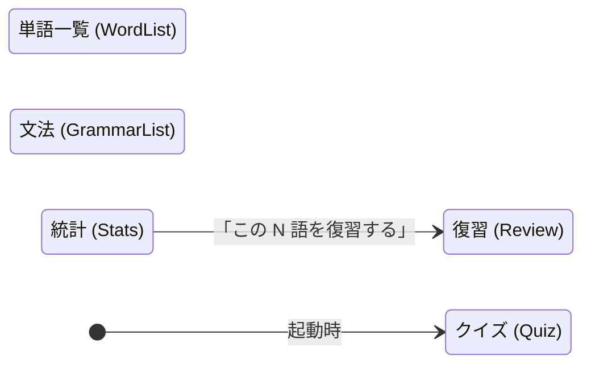
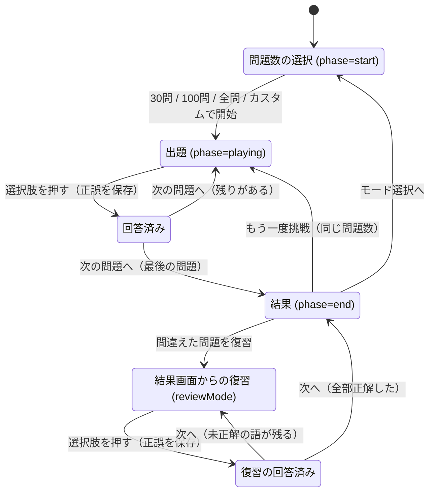
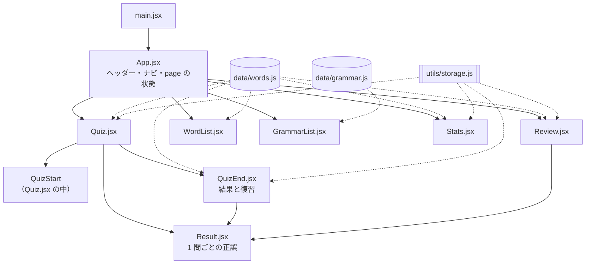
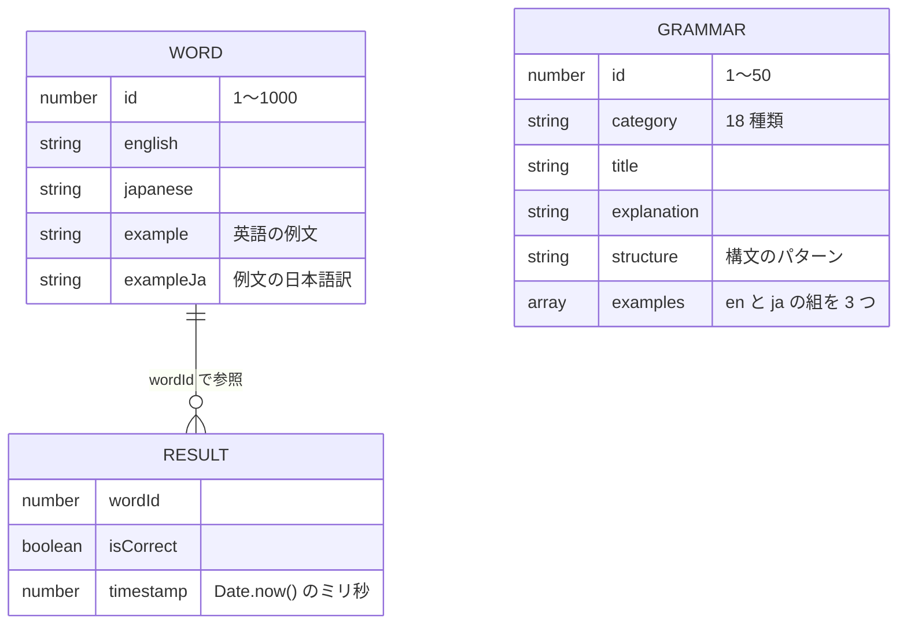
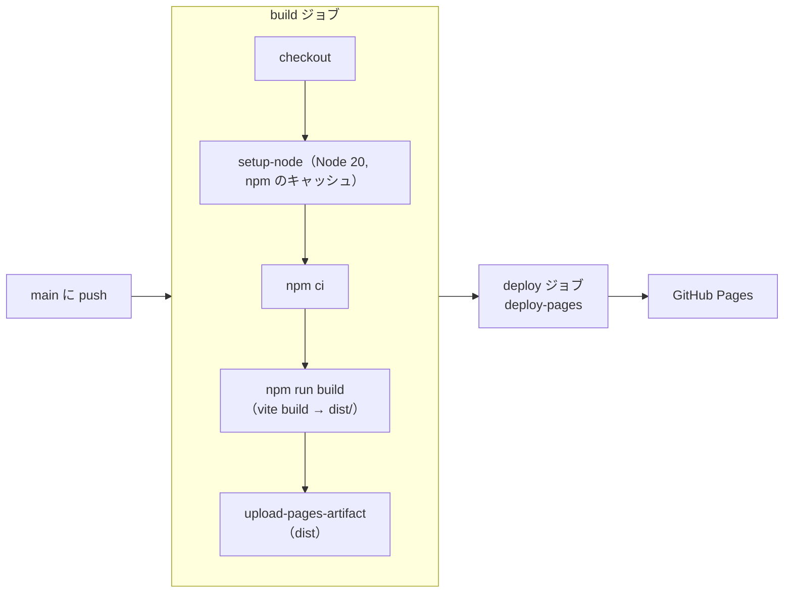

[https://maco165.github.io/english-vocab-app/](https://maco165.github.io/english-vocab-app/)
# 英単語道場

4択クイズ形式の英単語学習Webアプリ。1000語の英単語を繰り返し学習し、正誤記録をもとに効率的に復習できます。TOEIC・大学受験対策にも。

## 機能

### クイズモード
- **30問 / 100問 / 全問 / カスタム** から問題数を選択してスタート
- 英単語に対して4択から日本語の意味を選ぶ
- 回答後に正誤フィードバックと例文（英語・日本語）を表示
- プログレスバーで進捗を確認
- 終了時に正解率・不正解数を表示
- 間違えた問題だけをその場で復習可能

### 復習モード
- 過去に間違えた単語のうち、最後の回答が不正解のものだけを出題
- 一度正解すると復習リストから自動で除外（詳しくは「[データ](#データ)」）

### 単語一覧
- 全1000語を一覧表示
- 英語・日本語の意味・例文（英語・日本語訳）を確認
- 検索機能で単語を絞り込み

### 文法一覧
- 50項目の英文法をカテゴリ別に整理
- 時制、助動詞、受動態、不定詞・動名詞、関係詞、比較、仮定法など18カテゴリ
- 各項目に説明・構文パターン・例文3つ付き
- カテゴリフィルターと検索機能
- アコーディオン形式で開閉表示

### 統計
- 総回答数・正解数・不正解数・正解率を表示
- 間違えた単語の一覧（連続正解数バッジ・「この N 語を復習する」ボタン付き）
- 記録リセット機能

## 技術構成

| 項目 | 技術 |
|------|------|
| フレームワーク | React 19 |
| ビルドツール | Vite 7 |
| スタイル | CSS（CSS カスタムプロパティによるデザイントークン） |
| データ保存 | localStorage |
| 単語データ | 固定データ（1000語、例文・日本語訳付き） |
| 文法データ | 固定データ（50項目） |
| API | 不使用（完全オフライン動作） |

## セットアップ

```bash
# リポジトリをクローン
git clone https://github.com/<your-username>/english-vocab-app.git
cd english-vocab-app

# 依存パッケージをインストール
npm install

# 開発サーバーを起動
npm run dev

# プロダクションビルド
npm run build

# ビルド結果をプレビュー
npm run preview
```

## プロジェクト構成

```
english-vocab-app/
├── index.html               # HTMLエントリーポイント
├── package.json
├── vite.config.js
└── src/
    ├── main.jsx              # Reactエントリーポイント
    ├── App.jsx               # メインアプリ（ナビゲーション）
    ├── App.css               # ヘッダー・ナビ・レイアウト
    ├── index.css             # グローバルリセット・デザイントークン・共通部品
    ├── data/
    │   ├── words.js          # 英単語データ（1000語）
    │   └── grammar.js        # 文法データ（50項目）
    ├── components/
    │   ├── icons.jsx         # インライン SVG アイコン
    │   ├── Quiz.jsx          # クイズ画面（モード選択・出題）
    │   ├── Quiz.css
    │   ├── QuizEnd.jsx       # クイズ終了画面（結果・セッション復習）
    │   ├── Result.jsx        # 1問ごとの正誤フィードバック
    │   ├── Result.css
    │   ├── Review.jsx        # 復習モード（間違えた単語のみ）
    │   ├── Review.css
    │   ├── Stats.jsx         # 統計画面
    │   ├── Stats.css
    │   ├── WordList.jsx      # 単語一覧（検索付き）
    │   ├── WordList.css
    │   ├── GrammarList.jsx   # 文法一覧（カテゴリ・検索付き）
    │   └── GrammarList.css
    └── utils/
        └── storage.js        # localStorage操作ユーティリティ
```

## 設計

この節は `main` のコードから書いています。結果画面を作り直す PR #7 がマージされたら更新します。

### 構成

サーバーを持たない静的なアプリです。GitHub Pages が配る HTML・JS・CSS がブラウザの中だけで動き、単語と文法のデータは JS に同梱されています。回答の記録はブラウザの localStorage に保存するので、外部との通信はページの読み込みだけです。

<picture>
  <source media="(prefers-color-scheme: dark)" srcset="docs/architecture-dark.png">
  
</picture>

図の元は [`docs/architecture.html`](docs/architecture.html) です（stack-diagram で作成）。

### 画面遷移

ページはヘッダーのナビで切り替えます。URL は変わらず、`App.jsx` の `page` の状態だけで表示を切り替えます。ナビからはどのページにも直接移れます。図には、ナビ以外の移り方だけを矢印で描いています。



クイズのページの中では、次の順に状態が移ります。`Quiz.jsx` の `phase`（`start` / `playing` / `end`）と、`QuizEnd.jsx` の `reviewMode` で管理しています。



全部正解したときに出るはずの「復習完了！」の画面には、今の作りでは届きません（[既知の課題](#既知の課題)）。

### コンポーネント構成

実線は描画の親子、点線はデータと保存処理の参照です。アイコン（`icons.jsx`）はほぼすべての画面が使うので省いています。



### データ

単語と文法は JS の配列として同梱しています。回答の記録だけが localStorage に入ります。



| 置き場所 | 中身 | 件数 |
|---|---|---|
| `src/data/words.js` | `WORD` の配列 | 1000 語 |
| `src/data/grammar.js` | `GRAMMAR` の配列 | 50 項目（18 カテゴリ） |
| localStorage の `vocab-quiz-results` | `RESULT` の配列を JSON にしたもの。回答するたびに末尾に 1 件足す | 回答した数だけ増える。上限は無い |

統計と復習の対象は、保存した `RESULT` をその都度読み直して計算します（`utils/storage.js`）。

- `getStats()`: 総回答数・正解数・不正解数・正解率と、単語ごとの正解数・不正解数・連続正解数（`streak`）を出す。`streak` は正解で 1 増え、不正解で 0 に戻る
- `getMistakeWordIds()`: 一度でも間違え（`incorrect > 0`）、かつ最後の回答が不正解（`streak === 0`）の単語を復習の対象にする。そのため、一度正解すると対象から外れる
- `resetResults()`: 統計の画面の「記録をリセット」で、キーごと消す

### ビルドと公開

`main` に push すると、GitHub Actions（`.github/workflows/deploy.yml`）がビルドして GitHub Pages に公開します。公開先は `https://maco165.github.io/english-vocab-app/` で、`vite.config.js` の `base` を `/english-vocab-app/` にしてパスを合わせています。



同じグループ（`pages`）の実行が重なったときは、古いほうを取り消します（`concurrency.cancel-in-progress`）。PR の段階で動くチェックはありません。

### 既知の課題

| 課題 | 場所 | 中身 |
|---|---|---|
| 「復習完了！」の画面に届かない | `src/components/QuizEnd.jsx` の `handleNext` | 結果画面からの復習で最後の 1 語に正解すると、`reviewMode` を false に戻すので結果画面に戻る。完了の画面は `reviewMode` が true で問題が無いときだけ出るが、その状態にならない |
| スマホでナビが 2 段に折り返す | `src/App.css` の `@media (max-width: 839px)` と `.mobile-nav` | 839px 以下ではナビの 5 つのボタンが幅に合わせて折り返し、390px では「クイズ・復習・単語一覧」と「文法・統計」の 2 段になる。ハンバーガーメニュー（`.mobile-nav`）は JSX に残っているが、CSS で常に非表示にしている。`App.css` のコメントには、メニューより折り返しのほうを選んだと書かれている |
| lint のエラーが 1 件ある | `src/App.jsx:107` | 復習のページを開くたびに作り直すため `<Review key={Date.now()} />` としている。描画中に `Date.now()` を呼ぶので `react-hooks/purity` に当たる |

## レスポンシブ対応

- 中身の段組みはブレークポイントを設けず、`flex-wrap` と `repeat(auto-fit, minmax(min(Npx, 100%), 1fr))` で折り返す
- ヘッダーだけ 839px 以下で組み方を変える（`App.css` の `@media (max-width: 839px)`）。1 段目にロゴと GitHub のアイコン、2 段目にナビを置き、ナビは幅に合わせて折り返す。GitHub のリンクは文字を消してアイコンだけにする
- スマホ幅ではカード・選択肢が 1 列になる

## デザイン

- 明るく親しみやすいテーマ（生成りの地色＋白カード＋朱色アクセント）
- 背景: `#FBF8F2`（生成り）/ カード: `#FFFFFF`
- アクセント: `#C9461F`（朱）/ 復習: `#B7791F`（琥珀）
- 正解: `#1E7F6E`（ティール）/ 不正解: `#C9461F`（朱）。赤／緑の対比は使わない
- フォント: Zen Maru Gothic（日本語）＋ Nunito（英単語・数字）

## ライセンス

[MIT](./LICENSE)
